<div align="center">

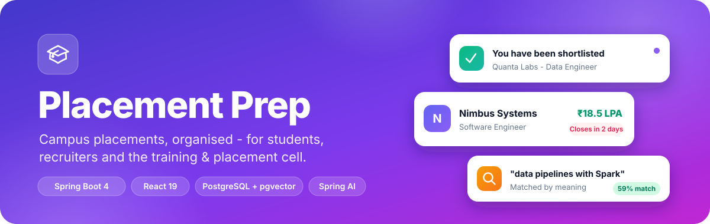

### The campus placement platform for students, recruiters and the training & placement cell

Drives with automatic eligibility · applications from apply to offer · deadline reminders ·
AI resume feedback grounded in the real job description · an AI assistant that acts through
tool calling · semantic search with pgvector

<br/>

[](https://github.com/RishitheB0T/placement-prep/actions/workflows/ci.yml)


**[Features](#-features)** · **[Screenshots](#-screenshots)** · **[Architecture](#%EF%B8%8F-architecture)** · **[AI & RAG](#-ai-and-rag)** · **[Quick start](#-quick-start)** · **[Docs](#-documentation)**

<br/>

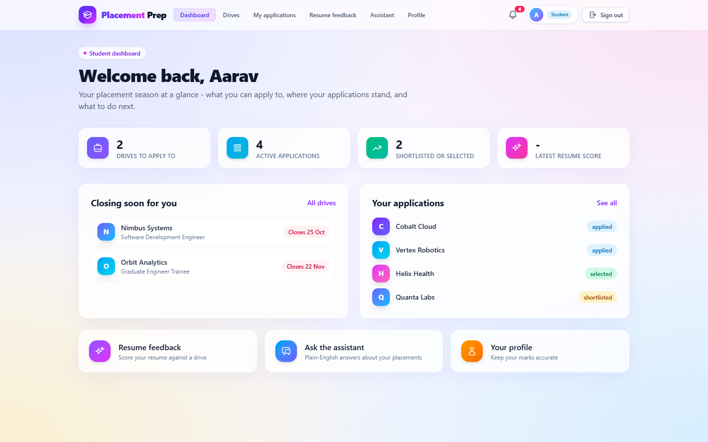

</div>

<br/>

## ✨ Features

<table>
<tr>
<td width="33%" valign="top">

### 🎯 Drives that fit you
Students see **only the drives their marks qualify for** - CGPA, 10th, 12th, branch and
backlogs, checked by one SQL query against their stored profile. Search the whole board by
company, role or branch.

</td>
<td width="33%" valign="top">

### 📋 Applications, end to end
Apply, withdraw, and follow every application from **applied → shortlisted → selected**.
The hiring side reviews applicants, leaves notes, sees live counts and downloads them as
CSV.

</td>
<td width="33%" valign="top">

### 🔔 Never miss a deadline
A scheduled job sends **new-drive alerts** and reminders **3 days and 1 day** before a
drive closes - only to eligible students who have not applied. Status changes land in the
same bell.

</td>
</tr>
<tr>
<td valign="top">

### 📄 AI resume feedback
Upload a PDF against a drive: **Claude reads it natively** and returns a score, strengths
and concrete fixes - judged against passages **retrieved from that drive's
job-description PDF**. Runs in a background queue.

</td>
<td valign="top">

### 🤖 An assistant that acts
Ask in plain English - *"which drives can I apply to?"*, *"apply me to Nimbus"*. Through
**Spring AI `@Tool` calling** the model invokes real backend methods, under the same rules
as the buttons.

</td>
<td valign="top">

### 🔍 Search by meaning (RAG)
Job-description PDFs are split, embedded by a **local model** and stored in **pgvector**.
*"Data pipelines with Spark"* finds the right job even when no word matches - with no API
key at all.

</td>
</tr>
<tr>
<td valign="top">

### 🔐 Four roles, enforced twice
**Student, coordinator, recruiter, admin** - JWT auth with role rules in the security
filter chain, plus row-level ownership: a recruiter only ever sees the drives they posted.

</td>
<td valign="top">

### 🧱 Built to be trusted
Flyway-owned schema, validation that mirrors every column, RFC 9457 errors, **228 backend
tests on real PostgreSQL + pgvector** via Testcontainers, CI on every push.

</td>
<td valign="top">

### 🐳 One command to run
`docker compose --profile app up` starts PostgreSQL, the Spring Boot API and the
nginx-served React app together - no JDK or Node needed.

</td>
</tr>
</table>

### 👥 Built for four roles

| | Role | What they do |
| :---: | --- | --- |
| 🎓 | **Student** | Builds a profile, sees eligible drives, applies, tracks applications, gets reminders, resume feedback and the assistant |
| 📋 | **Coordinator** | A student who helps run the cell - everything a student does, **plus** posting drives and reviewing every applicant |
| 💼 | **Recruiter** | A company's hiring contact, added by the admin - posts drives and decides applications, **for their own drives only** |
| ⭐ | **Admin** | The person in charge of the placement cell - oversees everything, adds recruiters, promotes coordinators, resets passwords |

<br/>

## 📸 Screenshots

<table>
<tr>
<td width="50%">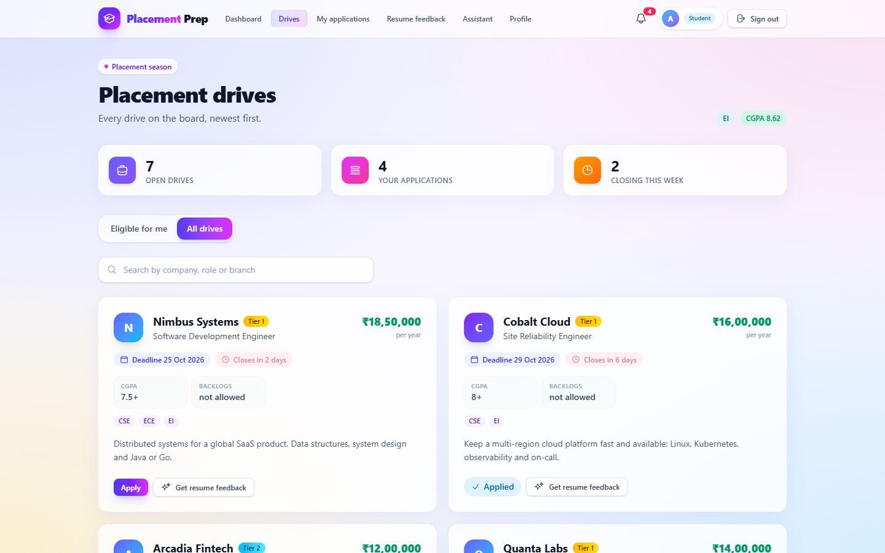<p align="center"><b>Drives board</b> - Apply only where you qualify, live deadlines</p></td>
<td width="50%">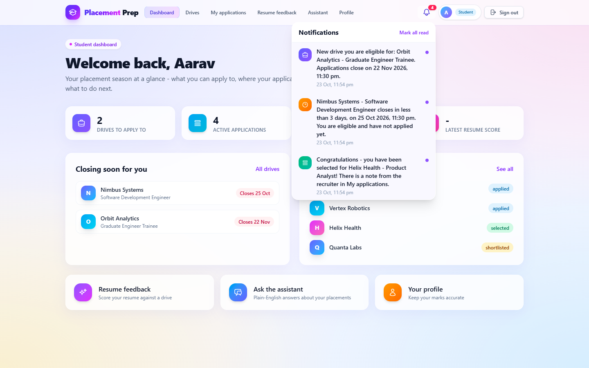<p align="center"><b>Notifications</b> - new drives, deadlines, decisions</p></td>
</tr>
<tr>
<td>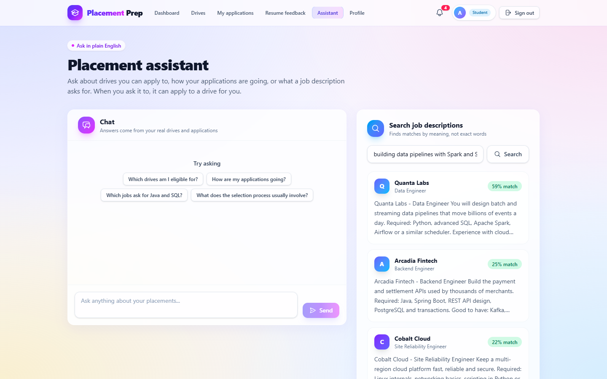<p align="center"><b>Assistant + semantic search</b> - matched by meaning via pgvector</p></td>
<td>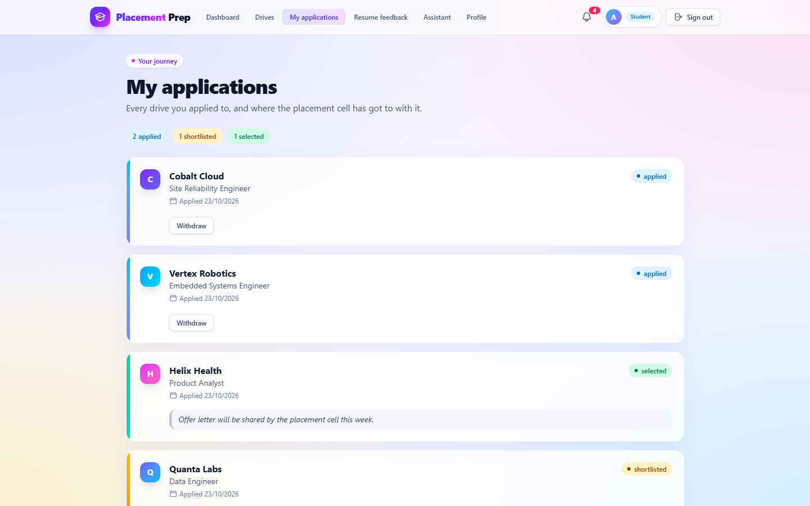<p align="center"><b>My applications</b> - status and the recruiter's notes</p></td>
</tr>
<tr>
<td>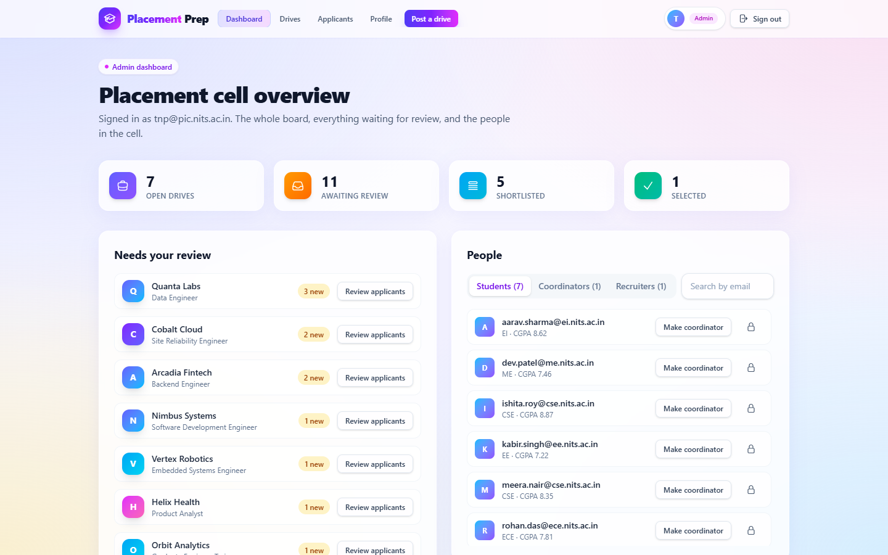<p align="center"><b>Admin dashboard</b> - the whole cell, people and promotions</p></td>
<td>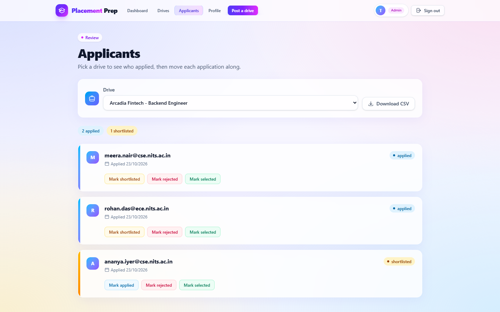<p align="center"><b>Reviewing applicants</b> - decide in a click, export as CSV</p></td>
</tr>
</table>

<details>
<summary><b>More screenshots</b> - sign-in, recruiter dashboard, posting a drive, eligible drives</summary>
<br/>
<table>
<tr>
<td width="50%">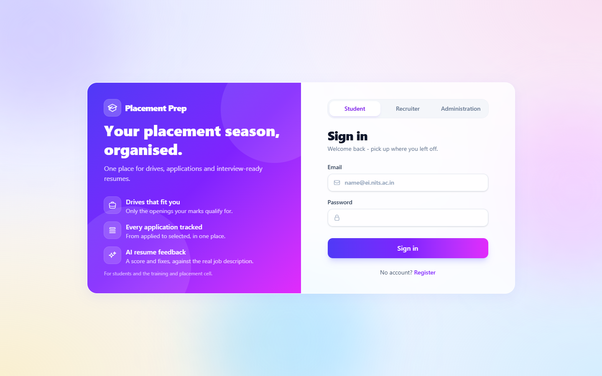<p align="center"><b>Sign in</b> - one form, a tab per kind of account</p></td>
<td width="50%">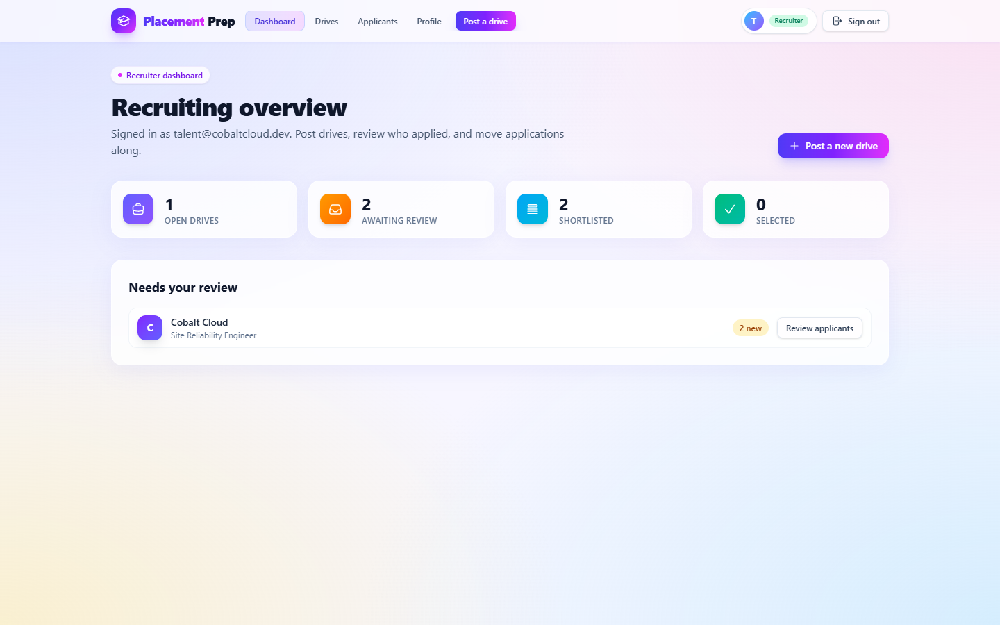<p align="center"><b>Recruiter dashboard</b> - scoped to the company's own drives</p></td>
</tr>
<tr>
<td>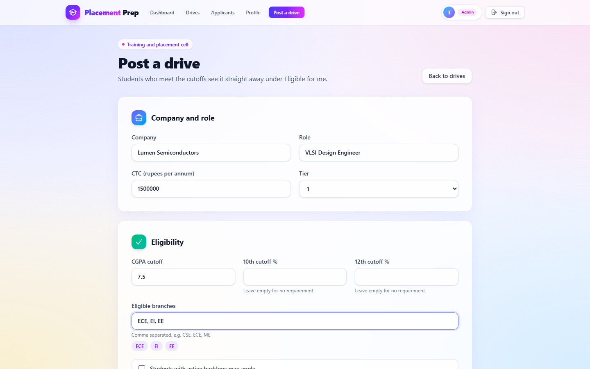<p align="center"><b>Posting a drive</b> - cutoffs, branches, deadline</p></td>
<td>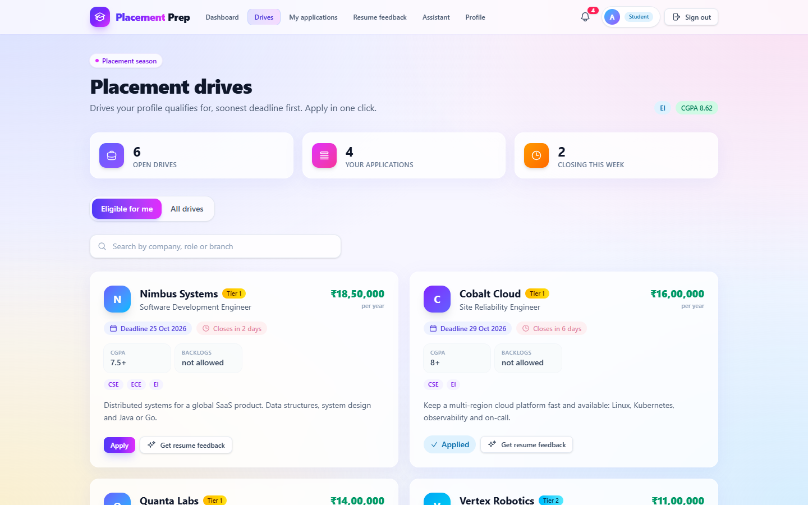<p align="center"><b>Eligible for me</b> - computed from the stored profile</p></td>
</tr>
</table>
</details>

<sub>Screenshots use fictional companies and students.</sub>

<br/>

## 🏗️ Architecture

A **modular monolith**: one Spring Boot API split into feature modules, one React
single-page app, and one PostgreSQL database that also stores the vector embeddings.

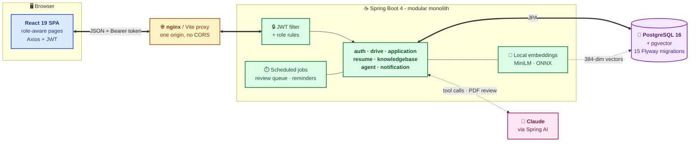

**Highlights of the design** - each explained in the [architecture deep dive](docs/ARCHITECTURE.md):

- 🔒 **Stateless JWT, role re-read from the database on every request** - a promotion takes effect immediately, and the browser refreshes its token to match.
- 🧩 **Controllers speak HTTP, services speak the domain** - services return `Optional` or throw a reason-carrying exception, so scheduled jobs reuse them untouched.
- 🛡️ **Two layers of access control** - role rules in the filter chain (`403`), ownership lookups that answer `404` so nobody can confirm another person's records exist.
- 📬 **A database table as a job queue** - resume reviews survive restarts with no message broker; no connection is held during the slow model call.
- 🧵 **Java 21 virtual threads** - every request runs on one, so slow model calls cannot use up a thread pool; the scheduled jobs keep a small pool of their own.
- 🔁 **At-most-once reminders** - a partial unique index makes "never send the same reminder twice" a database rule.

<br/>

## 🧠 AI and RAG

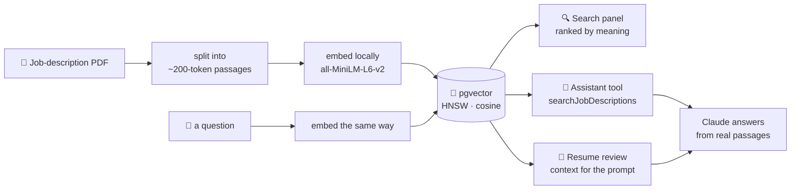

| | How it works |
| --- | --- |
| **Retrieval (R)** | PDFs are read with PDFBox, split by tokens, embedded **inside the JVM** and stored in pgvector with an HNSW index. A search embeds the question the same way and returns the nearest passages by cosine distance. |
| **Generation (G)** | The assistant's `searchJobDescriptions` tool and the resume reviewer put the retrieved passages in front of Claude, so answers and feedback quote what the job actually asks for. |
| **Tool calling** | Five `@Tool` methods - eligible drives, all drives, my applications, apply, search. Spring AI runs the loop: the model asks for a tool, the Java method runs, the result goes back. Tools are bound to the signed-in student, so the model can never reach anyone else's data. |
| **Structured output** | The resume review comes back as JSON parsed straight into a Java record - score, summary, strengths, improvements - with the score clamped to 0-100. |

<br/>

## 🛠️ Tech stack

<p align="center">
  
</p>

| Layer | Technology |
| --- | --- |
| **Backend** | Java 21 (virtual threads) · Spring Boot 4.1 · Spring Web MVC · Spring Security 7 + JWT (jjwt) · Spring Data JPA · Bean Validation · Flyway |
| **AI** | Spring AI 2.0 · Anthropic Claude (chat, tool calling, native PDF reading) · all-MiniLM-L6-v2 via ONNX Runtime · PDFBox |
| **Data** | PostgreSQL 16 · pgvector (HNSW, cosine) |
| **Frontend** | React 19 · TypeScript · Vite · React Router 7 · Axios · Tailwind CSS 4 |
| **Testing** | JUnit · Mockito · MockMvc · Testcontainers · Vitest · React Testing Library · Postman |
| **Delivery** | Docker multi-stage images · nginx · Docker Compose · GitHub Actions · Render |

<br/>

## 🚀 Quick start

**Everything in Docker** - only Docker needed:

```bash
git clone https://github.com/RishitheB0T/placement-prep.git
cd placement-prep
docker compose --profile app up -d --build
```

Open **http://localhost:3000** and sign in on the **Administration** tab as the seeded
person in charge - `tnp@pic.nits.ac.in` / `9676596160` - then post a drive, or register a
student with any `name@<dept>.nits.ac.in` address. Set `ANTHROPIC_API_KEY` before starting
to switch on resume feedback and the assistant; semantic search works without it.

<details>
<summary><b>Development mode</b> - hot reload for backend and frontend</summary>

```bash
docker compose up -d                                  # PostgreSQL + pgvector on :5433
cd backend  && ./mvnw spring-boot:run                 # API on :8081  (Windows: .\mvnw.cmd)
cd frontend && npm install && npm run dev             # app on :5173
```

Configuration, ports and every command are in the [development guide](docs/DEVELOPMENT.md).
</details>

<br/>

## ✅ Quality

| | |
| --- | --- |
| 🧪 **228 backend tests** | Integration tests on **real PostgreSQL + pgvector** (Testcontainers) with real signed JWTs; unit tests for every service; the AI tool-calling loop tested against a fake Anthropic server |
| 🧪 **89 frontend tests** | Vitest + React Testing Library - every role gets exactly the controls it should |
| 📮 **85 Postman requests** | Every endpoint, each restricted one called by a role that may and one that may not - 114 assertions |
| 🔁 **CI** | GitHub Actions builds and tests backend and frontend on every push |
| 🧹 **Lint** | oxlint - 0 warnings |

<br/>

## 📁 Project structure

```
placement-prep/
├── backend/                     Spring Boot API
│   └── src/main/java/.../placementprep/
│       ├── infrastructure/          security (JWT, rules) · ai (ChatClient)
│       └── modules/
│           ├── auth/                accounts, login, roles, passwords
│           ├── drive/               drives, eligibility, recruiter scoping
│           ├── application/         apply, withdraw, decide, statistics
│           ├── notification/        notifications + deadline reminder job
│           ├── resume/              upload, review queue, AI reviewer
│           ├── knowledgebase/       RAG over job descriptions (pgvector)
│           └── agent/               the assistant and its @Tool methods
│       (every module: controller · service · repository · model · dto)
├── frontend/                    React + TypeScript app
│   └── src/  api/ · components/ · pages/
├── docs/                        architecture, API, development guide, images
├── postman/                     collection + sample PDFs
├── docker-compose.yml           PostgreSQL, and the full app with --profile app
└── render.yaml                  free showcase deployment on Render
```

<br/>

## 📚 Documentation

| Document | What's inside |
| --- | --- |
| 🏗️ [**Architecture**](docs/ARCHITECTURE.md) | Every flow with diagrams - request path, sign-in, roles, the application lifecycle, reminders, the review queue, RAG, tool calling, the data model |
| 📡 [**API reference**](docs/API.md) | All 35 endpoints with roles, fields, status codes and examples |
| 🧑‍💻 [**Development guide**](docs/DEVELOPMENT.md) | Setup, configuration, commands, testing and CI |

<br/>

## 🗺️ Roadmap

- ✅ Drives board with automatic eligibility, search
- ✅ Applications - apply, withdraw, decide, notes, CSV export
- ✅ Four roles with JWT, recruiter scoping, admin tools
- ✅ Notifications and deadline reminders
- ✅ AI resume feedback, grounded in the job description
- ✅ AI assistant with tool calling
- ✅ Semantic search over job descriptions (RAG, pgvector)
- ✅ Docker images and CI
- 🔜 Company-wise AI mock interviews
- 🔜 Q&A over placement notices, with sources
- 🔜 Email delivery for reminders and password reset

<br/>

<div align="center">

Built by **[Rishikesh Kallapally](https://github.com/RishitheB0T)**

</div>
