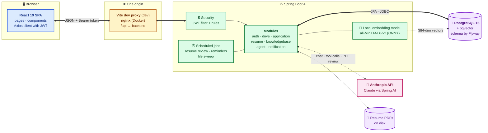
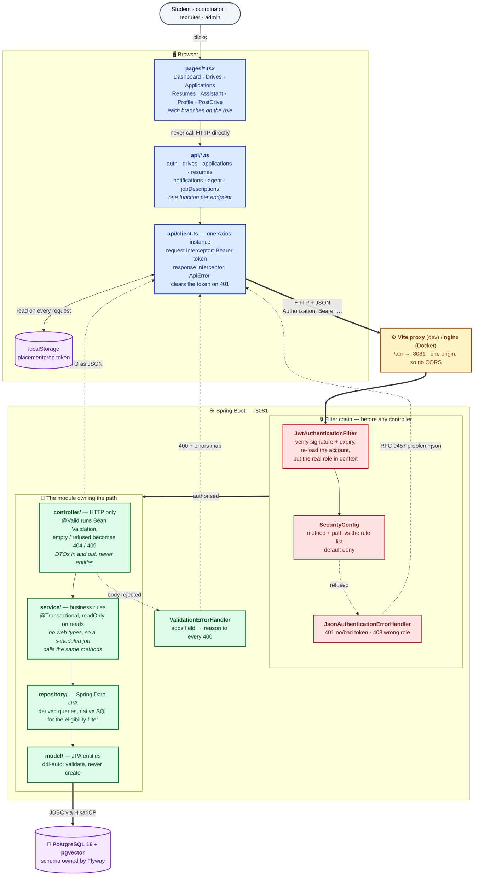
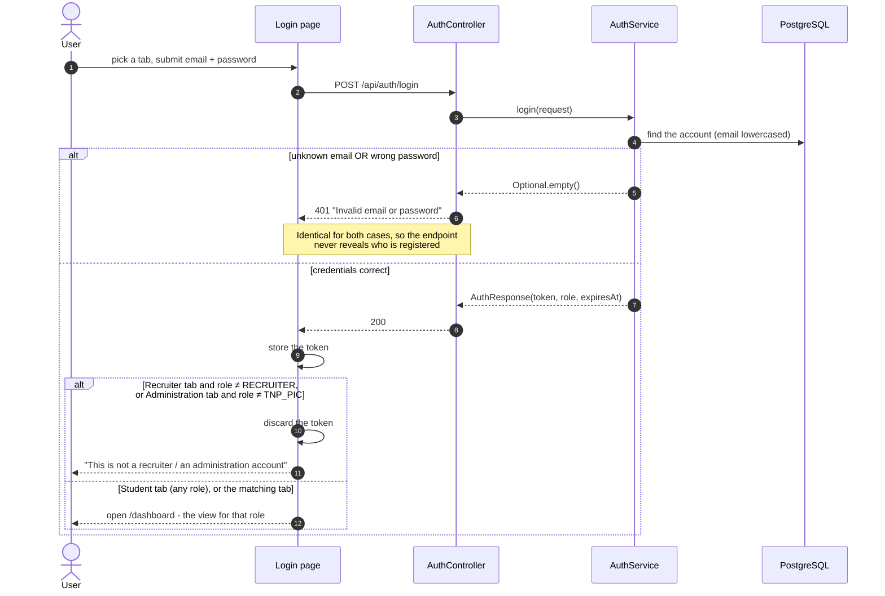
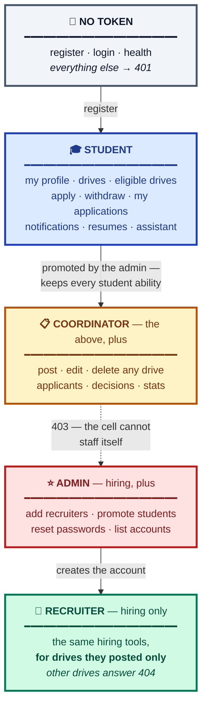
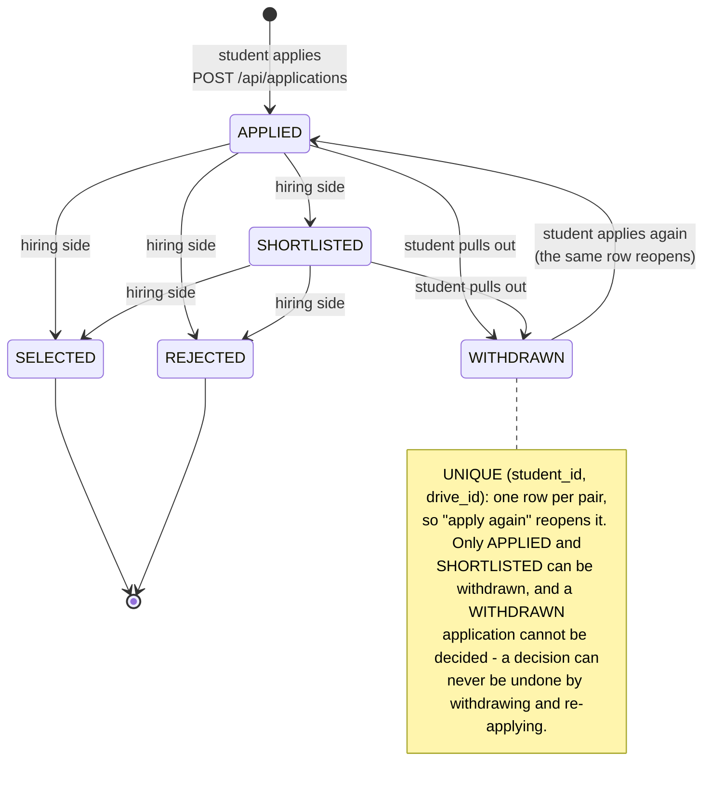
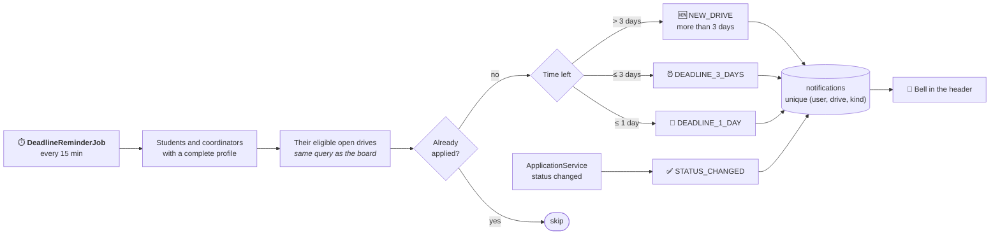
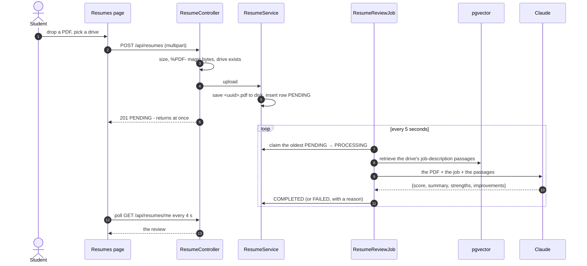
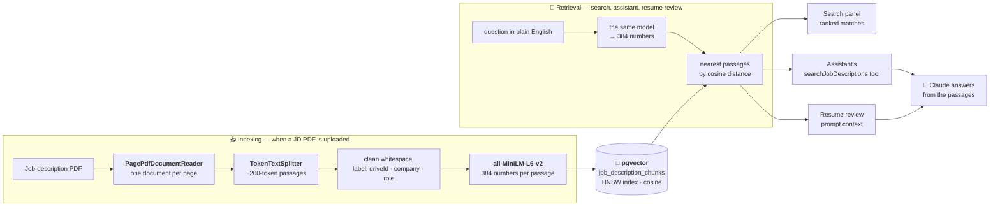
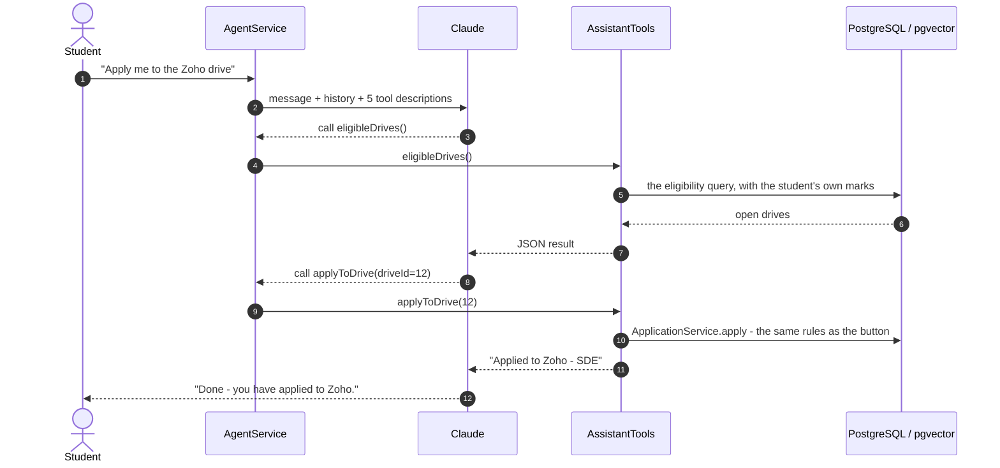
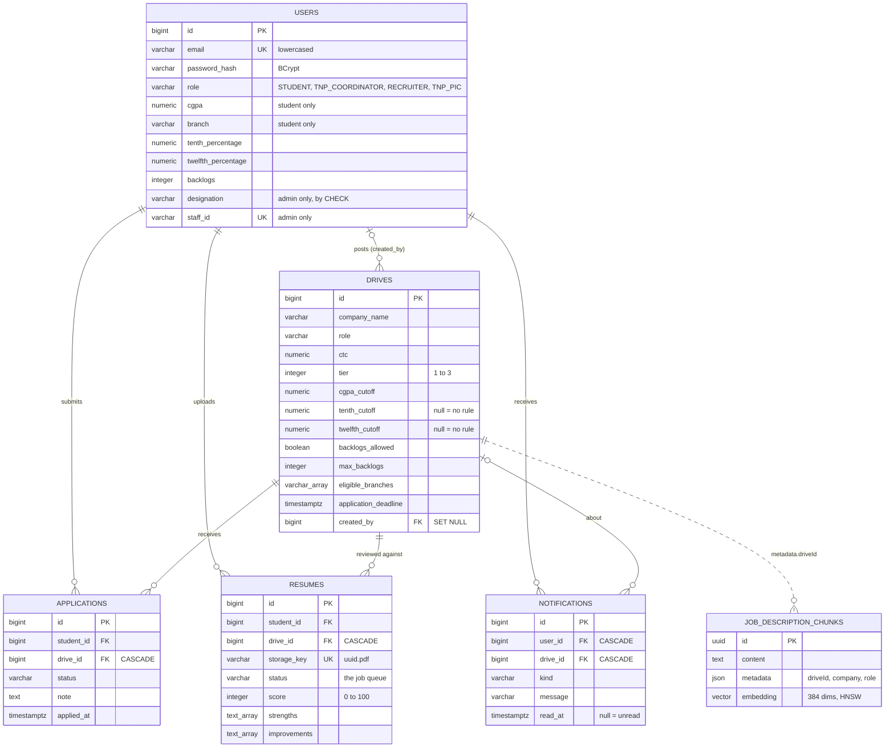

# Architecture

How Placement Prep is put together, from the browser down to the database, and why each
piece is shaped the way it is. For setup see [DEVELOPMENT.md](DEVELOPMENT.md); for every
endpoint see [API.md](API.md).

**Contents**

1. [The big picture](#1-the-big-picture)
2. [A request, layer by layer](#2-a-request-layer-by-layer)
3. [Signing in](#3-signing-in)
4. [Roles and who may call what](#4-roles-and-who-may-call-what)
5. [The life of an application](#5-the-life-of-an-application)
6. [Notifications and deadline reminders](#6-notifications-and-deadline-reminders)
7. [Resume feedback: a database table as a job queue](#7-resume-feedback-a-database-table-as-a-job-queue)
8. [RAG: job-description search by meaning](#8-rag-job-description-search-by-meaning)
9. [The AI assistant: tool calling](#9-the-ai-assistant-tool-calling)
10. [The data model](#10-the-data-model)
11. [Background jobs](#11-background-jobs)
12. [Design principles](#12-design-principles)

---

## 1. The big picture

A modular monolith: one Spring Boot backend split into feature modules, one React
single-page app, one PostgreSQL database that also stores vector embeddings.

| Piece | Choice | Why |
| --- | --- | --- |
| Shape | Modular monolith | One deployable and one database is the right size for one college; the module boundaries keep a later split possible |
| API style | REST + JSON, RFC 9457 errors | One error shape for the whole API, so one client-side handler covers everything |
| Auth | Stateless JWT | Any instance can serve any request; no session storage |
| Vectors | pgvector in the same PostgreSQL | No second database to run; SQL and similarity search side by side |
| Embeddings | Local ONNX model | Free, private, and works with no API key at all |
| Generation | Claude through Spring AI | Native PDF reading for resumes, and first-class tool calling for the assistant |

---

## 2. A request, layer by layer

Every request in the application takes this path. Nothing bypasses it.

| Claim | Why it matters |
| --- | --- |
| **The token travels on every request.** | `api/client.ts` attaches `Authorization: Bearer <token>` to all calls. There is no session and no cookie; the server keeps nothing between requests. |
| **The role is re-read from the database on every request.** | `JwtAuthenticationFilter` does not trust the `role` claim inside the token, so a promotion takes effect on the *next* request. The browser catches up too: when the profile and the token disagree, it fetches a fresh token from `/api/auth/refresh`, so the new pages appear without signing in again. |
| **A 401 or 403 never reaches a controller.** | The rules run inside the filter chain, before dispatch. A controller method never needs a role check of its own. |
| **Controllers never see or return an entity.** | Everything crossing the HTTP boundary is a DTO, so the database shape and the API shape change independently. |
| **Services never decide status codes.** | A service returns `Optional`/`boolean` or throws a domain exception naming the reason; the controller maps that to `404`/`409`. The same method stays callable from a scheduled job. |
| **Frontend role checks are convenience, never security.** | Hiding "Post a drive" from a student is a nicety. What actually stops them is the backend answering `403` - which is what the tests assert. |
| **No CORS configuration exists anywhere.** | The Vite proxy (development) and nginx (Docker) make the browser see a single origin. |

---

## 3. Signing in

One login endpoint, three tabs. The tabs are the *same* HTTP call; what differs is what the
frontend does with the answer.

- **Registration** always creates a `STUDENT` and accepts college addresses only
  (`name@<dept>.nits.ac.in`; a dot before `nits.ac.in` blocks lookalikes such as
  `notnits.ac.in`). The request has no role field, so nobody can register as staff.
- **The token** is HMAC-SHA256 signed by `JwtService`, expires after 24 hours, and carries
  the email and role. Its payload is readable by anyone, so nothing secret goes in it.
- **Recruiters** cannot register: the admin creates their account with a company email.
- **Passwords** are BCrypt-hashed. Any account can change its own password (the current
  one is checked again); the admin can set a temporary one for someone who forgot theirs.

---

## 4. Roles and who may call what

| Role | Shown as | What it can do |
| --- | --- | --- |
| `STUDENT` | Student | Browse and search drives, see the ones they qualify for, apply and withdraw, get notifications, resume feedback, the assistant |
| `TNP_COORDINATOR` | Coordinator | Everything a student can (a coordinator *is* a student) **plus** post, edit and delete drives and review every applicant |
| `RECRUITER` | Recruiter | A company's hiring contact: posts drives and reviews applicants **for their own drives only**. Not a student |
| `TNP_PIC` | Admin | The person in charge: everything on the hiring side, plus adding recruiters, promoting students, resetting passwords. Not a student |

**Two layers of protection.** `SecurityConfig` decides *which roles* may call an endpoint
(`403` otherwise). Ownership lookups decide *which rows* a caller may touch (`404`
otherwise): a student's application is found by `(id, studentId)`, a notification by
`(id, userId)`, a recruiter's drive by `(id, created_by)`. Answering `404` instead of `403`
means a caller can never confirm that someone else's record exists.

**"Is this account management?" and "is this account a student?" are independent
questions**, asked separately on both sides: `MANAGERS` and `STUDENTS` in `SecurityConfig`,
mirrored by `canManageDrives` and `isStudentRole` in `frontend/src/api/roles.ts`. A
coordinator answers yes to both, so they see **Apply** and **Delete** on the same card.

**How "a recruiter sees only their own drives" works.** Every drive records who posted it
(`drives.created_by`). `UserProfileDTO.driveScope()` turns the signed-in account into a
*scope* - the recruiter's own id, or empty for everyone else - and the controllers pass it
to `DriveService`, where one private `findVisible(id, scope)` applies the rule to every
scoped read and write. The account lookup fails closed: a missing account is a `404`,
never "no scope".

---

## 5. The life of an application

Applying is checked in one place, `ApplicationService.apply`, shared by the **Apply**
button and the assistant's `applyToDrive` tool:

| # | Check | If it fails |
| --- | --- | --- |
| 1 | The drive exists | `404` |
| 2 | No active application already | `409` |
| 3 | The deadline has not passed | `409` |
| 4 | The profile is complete | `409` |
| 5 | The stored marks meet the drive's criteria - the same query as "Eligible for me" | `409` |

A refusal is a domain exception (`ApplicationRefusedException` with a `Reason`), so the
service stays free of HTTP types: the controller maps the reason to a status, and the
assistant hands the message back to the model. Every status change sends the student a
notification, written in the same transaction.

**The eligibility rule.** A drive is open to a student when every cutoff is met - each
written `(cutoff IS NULL OR cutoff <= :value)`, because in SQL a comparison with `NULL` is
neither true nor false - the branch is in the drive's list (case-insensitive), backlogs are
within what the drive allows, and the deadline is in the future.

---

## 6. Notifications and deadline reminders

- **At most once.** Each reminder is sent once per student, drive and kind - checked
  before inserting, and enforced by a *partial unique index* in the database
  (`WHERE kind <> 'STATUS_CHANGED'`, because an application can be shortlisted and later
  selected). That is what makes running the job every few minutes safe.
- **Fault isolation.** Each notification is its own short transaction, so one failing
  student is logged and skipped without undoing anyone else's reminders.
- **The bell** loads when the header mounts, shows an unread badge, and marks a
  notification read when it is opened; "mark all read" is one `UPDATE`.

---

## 7. Resume feedback: a database table as a job queue

- **The `resumes` table is the queue.** No message broker: work survives a restart, and
  rows stuck in `PROCESSING` after a shutdown are put back on startup.
- **No connection is held during the slow call.** Claiming a row is its own short
  transaction; the model call happens outside any transaction.
- **The PDF goes to Claude as a native document**, so no PDF parsing is needed, and the
  reply is parsed straight into a Java record with `.entity(Review.class)`.
- **Grounded in the real job description.** Before each review, the job retrieves the most
  relevant passages of the drive's uploaded job-description PDF from pgvector - the
  retrieval step of RAG - so feedback can say whether the resume shows what the job asks
  for. If retrieval fails, the review still runs without them.
- **Safe storage.** The server names every file (`<uuid>.pdf`), so the client's filename
  is never used as a path. A sweep every six hours deletes files whose row is gone (a
  deleted drive cascades its rows, but a database cannot delete files).

---

## 8. RAG: job-description search by meaning

**RAG** (retrieval-augmented generation): find the passages relevant to a question, then
give them to the language model so it answers from real documents instead of memory.

- **Search by meaning, not words.** "server-side programming with databases" finds a job
  description that says "Java, Spring Boot, SQL" with no word in common - a test proves it
  against a real pgvector database.
- **Local and pinned.** The embedding model runs inside the JVM (ONNX Runtime), needs no
  API key, and is pinned to one model revision so stored vectors stay comparable.
- **Replace, not append.** Re-uploading a drive's PDF deletes its old passages in the same
  transaction; deleting the drive removes them too.
- **Scoped retrieval.** The resume reviewer filters by `driveId`, so a review is only ever
  judged against its own drive's job description.

---

## 9. The AI assistant: tool calling

**Tool calling**: the model is told which Java methods exist. Instead of answering
directly it can reply "call this method with these arguments"; Spring AI runs the method,
sends the result back, and the model continues with real data.

| Tool | Does |
| --- | --- |
| `eligibleDrives()` | Open drives the student qualifies for |
| `allDrives()` | Every drive on the board |
| `myApplications()` | The student's applications, with company names |
| `applyToDrive(driveId)` | Applies through `ApplicationService.apply` - every rule still applies |
| `searchJobDescriptions(query)` | The RAG search above |

**Safe by construction.** A new `AssistantTools` object is built for each request, bound
to the signed-in student; no tool takes a student id, so neither the model nor a cleverly
worded message can reach another student's data. Chat history is sent as typed message
objects rather than pasted into a template, at most 8 tool calls run per message, and the
server stores no conversation.

---

## 10. The data model

- **One `users` table for every role** keeps sign-in a single lookup. Student-only columns
  are nullable (marks are filled in after registering); the admin's staff columns are
  guarded by a `CHECK` - `role = 'TNP_PIC' OR (all IS NULL)`.
- **Cascades follow meaning.** Deleting a drive removes its applications, resumes,
  notifications and passages. Deleting a recruiter's account *keeps* their drives
  (`created_by` becomes `NULL` and the drive passes back to the cell).
- **Flyway owns the schema** (15 migrations); Hibernate only validates. An applied
  migration is never edited - Flyway checksums every file.

---

## 11. Background jobs

| Job | Runs | Does |
| --- | --- | --- |
| Resume review | every 5 s | drains the `PENDING` queue (section 7) |
| Requeue on startup | once, when the app is ready | puts interrupted `PROCESSING` reviews back |
| Deadline reminders | every 15 min, first after 1 min | section 6 |
| Orphan file sweep | every 6 h | deletes stored PDFs no row points at, if over an hour old |

All use `fixedDelay`, so a run never overlaps itself, and each job has a scheduler thread
of its own, so a slow model call never holds up the reminders. In tests, the automatic
runs are pushed a day out and tests trigger the jobs themselves.

### Threads

| Work | Runs on | Why |
| --- | --- | --- |
| Every HTTP request | a **Java 21 virtual thread** (`spring.threads.virtual.enabled`) | A request waiting on the database or the model parks its virtual thread, which costs next to nothing. With Tomcat's 200 pooled threads, 200 slow assistant chats would leave every other request queueing. |
| The three scheduled jobs | a pool of **3 platform threads**, declared in `PlacementprepApplication` | With virtual threads on, Spring Boot's own scheduler runs every fixed-delay job on *one* shared thread. A pool keeps the jobs independent; three jobs gain nothing from virtual threads. |

`PlacementprepApplicationTests` covers both: a real HTTP request must arrive on a virtual
thread, and a second job must start while the first is still busy.

---

## 12. Design principles

1. **Controllers speak HTTP, services speak the domain.** DTOs at the boundary; `Optional`,
   `boolean` or a reason-carrying domain exception inside; status codes only in controllers.
2. **One request record per resource** serves both `POST` and `PUT`; cross-field rules are
   `@AssertTrue` methods on the record.
3. **Validation mirrors the columns.** Every size and range matches the column it fills,
   so a value the database cannot hold is a `400` naming the field, never a `500`.
4. **Fail closed.** Default-deny security rules; a lookup failure never widens access.
5. **One place per rule.** Eligibility is one query; apply rules are one method; role lists
   are one constant on each side.
6. **Real dependencies in tests.** Integration tests run against PostgreSQL + pgvector in
   Docker (Testcontainers) with real signed tokens; the AI loop runs against a fake
   Anthropic server.

| Trade-off | Chosen | Cost accepted |
| --- | --- | --- |
| Token in `localStorage` | simple, survives refresh, nothing to forge with CSRF | readable by any script on the page |
| Table as a job queue | restart-safe, nothing extra to run | one backend instance (no row locking yet) |
| In-app notifications | no mail server | nobody is told while away from the site |
| Admin password reset | works without email | the admin hands over a temporary password |
| Local embeddings | free and private | ~350 MB first download |
